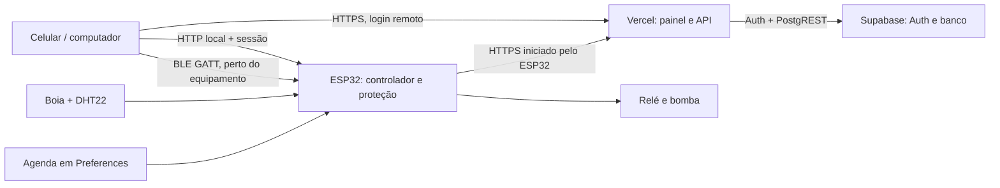

# Tomada Inteligente para Hidroponia — Makers Sala

Projeto científico e maker desenvolvido pela equipe **Makers Sala**, da Escola Estadual Adib Miguel Haddad. A tomada inteligente automatiza a circulação de água de um cultivo hidropônico, monitora o ambiente e bloqueia a bomba quando a chave boia detecta nível baixo. O sistema reúne ESP32, painel local, Bluetooth LE e painel remoto via Vercel + Supabase. A logo Makers Sala aparece no painel web.

## Apresentação pública

O projeto serve para estudar como automação de baixo custo pode apoiar a continuidade e a segurança de um cultivo hidropônico. No modo automático, a ESP32 executa horários programados mesmo sem celular ou internet. A chave boia tem prioridade sobre qualquer comando e impede o funcionamento da bomba quando falta água. O DHT22 registra temperatura e umidade do ar; o painel mostra estado, métricas, agenda e eventos. O controle pode ser feito perto do equipamento por Wi-Fi/Bluetooth ou remotamente pelo painel seguro, quando houver internet. A nuvem não substitui o controle local.

**Autoria:** equipe Makers Sala — Escola Estadual Adib Miguel Haddad. Os nomes individuais dos integrantes devem ser acrescentados pela equipe antes da publicação final, para evitar atribuição incorreta.

## Estado do projeto

- Firmware local: Wi-Fi station com reconexão, AP de emergência, painel HTTP, cookie de sessão, oito horários em `Preferences`, DHT22, boia, agenda autônoma, contadores persistentes e histórico com horário quando NTP está sincronizado.
- BLE: serviço GATT com estado de leitura e comandos; usa o mesmo executor e a mesma barreira de nível do controle HTTP.
- Remoto: painel atualizado publicado em https://adib-hidroponia-mika-projects1.vercel.app. Supabase, tabelas com RLS e variáveis Production da Vercel estão configurados. Login por usuário/senha e `/api/status` foram verificados; o dispositivo aparecerá online depois da primeira telemetria da ESP32.
- Sem equipamento conectado nesta pasta, não há confirmação de funcionamento físico, rádio BLE ou acionamento do relé.

## Arquitetura

O ESP32 permanece como autoridade do estado físico. A agenda e a proteção funcionam sem navegador, Bluetooth, internet, Vercel ou Supabase. A nuvem entrega comandos com validade curta; o dispositivo confirma recebimento e resultado. A interface não transforma o simples registro do comando no backend em confirmação de execução.

## Firmware local

### Hardware e pinagem

| Elemento | Conexão | Notas |
|---|---|---|
| ESP32 DevKit WROOM-32 | — | O código usa Wi-Fi e BLE integrados. |
| Entrada `IN` do relé | GPIO 23 | Relé ativo em LOW conforme o firmware recebido. |
| DHT22 `DATA` | GPIO 4 | Alimentar em 3,3 V; usar pull-up de 4,7–10 kΩ se o módulo não tiver. |
| Chave boia | GPIO 5 e GND | `INPUT_PULLUP`; LOW indica nível baixo. |
| Buzzer ativo | GPIO 18 e GND | O firmware pulsa 250 ms ligado / 750 ms desligado durante nível baixo, sem `delay()`. Use transistor se o buzzer exigir mais corrente que o GPIO pode fornecer. |
| Fonte 5 V | USB/VIN da placa e módulo relé | 2 A recomendada; mínimo 1 A. Não una fontes sem verificar o circuito da placa. |
| Bomba 5 W | Contatos `COM` e `NO` do relé | Carga da rede fica completamente separada do circuito lógico. |

### Ligações de baixa tensão

`ESP32 GPIO 23 → IN do relé`; `DHT22 DATA → GPIO 4`; `boia → GPIO 5 e GND`; `buzzer + → GPIO 18` e `buzzer − → GND`; GND do ESP32, DHT22, relé não isolado e driver da boia em comum. O DHT22 recebe 3,3 V. O relé recebe 5 V regulados. A boia fecha para GND quando indica nível baixo; confirme a orientação elétrica do componente antes do teste. O nível é considerado baixo já na inicialização se GPIO 5 estiver em LOW.

### Bibliotecas

No Arduino IDE, instale:

1. Placa **esp32 by Espressif Systems**, versão 2.0.17 ou 3.x. O BLE usa as bibliotecas incluídas no core ESP32.
2. **DHT sensor library by Adafruit** e sua dependência **Adafruit Unified Sensor**.
3. **ArduinoJson by Benoit Blanchon** (linha 6.x ou 7.x).

`WiFi`, `WebServer`, `Preferences`, `time`, `HTTPClient` e `WiFiClientSecure` vêm no core do ESP32.

### Configuração antes de gravar

O sketch inclui `HydroSecrets.h`, um arquivo privado que deve estar na mesma pasta do `.ino`. Ele guarda Wi-Fi, credenciais locais, URL Vercel, ID/token do dispositivo e certificado raiz TLS. O arquivo é ignorado pelo Git: não o publique, não o envie em capturas de tela e não o coloque no GitHub. Confirme a rede Wi-Fi 2,4 GHz e a senha no arquivo antes da gravação. Se a rede mudar, atualize o arquivo e regrave. A variável Vercel `DEVICE_TOKEN` deve corresponder ao token exclusivo do firmware; a validação TLS permanece ativa.

O AP de emergência usa o SSID `Hidroponia-ESP32`, senha privada definida como `AP_PASSWORD` em `HydroSecrets.h` e endereço `192.168.4.1`. Consulte o arquivo privado para a senha; ela não é publicada no repositório.

### Gravação

1. Mantenha `TomadaHidroponia.ino` e `HydroSecrets.h` na mesma pasta e abra o `.ino` no Arduino IDE.
2. Selecione **ESP32 Dev Module**, porta serial correta e velocidade 115200.
3. Compile e carregue por USB. Se a gravação ficar em `Connecting`, segure `BOOT` até iniciar.
4. Abra o Monitor Serial a 115200. O firmware não imprime senhas. Após 30 s sem conexão Wi-Fi, inicia o AP de emergência e mantém as tentativas de reconexão.
5. Na rede normal, use o IP anunciado no Monitor Serial. No AP, conecte o celular à rede e abra `http://192.168.4.1`.
6. `/ping` responde `pong`; `/teste` mostra uma página simples de diagnóstico HTTP, sem exigir login. O painel protegido usa `/` e `/login`.

Use o [manual completo da etapa 2](MANUAL_GRAVACAO_E_OPERACAO.md) para instalação, gravação, teste da nuvem Vercel, acesso Wi-Fi/BLE e solução de problemas.

O painel local usa usuário e senha configurados no firmware, sessão em cookie HTTP e expiração de oito horas. O comando HTTP retorna sucesso somente depois da decisão e atualização local; nível baixo produz rejeição. Os formulários não são apagados em cada atualização periódica.

## BLE GATT

Nome anunciado: `Hidroponia-ESP32`.

| UUID | Permissões | Uso |
|---|---|---|
| `7b4a0001-7f3a-4b69-9f33-3a4f8c2c1000` | Serviço | Serviço principal. |
| `7b4a0002-7f3a-4b69-9f33-3a4f8c2c1000` | Read, Notify | JSON compacto de estado: bomba, nível, modo, sensores, ciclos, tempo, rede e NTP. |
| `7b4a0003-7f3a-4b69-9f33-3a4f8c2c1000` | Write, Write Without Response | Um comando JSON. O callback apenas enfileira; o `loop()` executa e verifica a proteção. |
| `7b4a0004-7f3a-4b69-9f33-3a4f8c2c1000` | Read, Notify | Confirmação JSON da última solicitação. |

Comandos de controle: `{"id":"UUID-DO-CLIENTE","action":"on"}`, ou `off`, `auto`. Para enviar programação: `{"id":"UUID-DO-CLIENTE","action":"schedules","payload":[{"enabled":true,"start":"08:00","stop":"08:15"}, ...]}`; o array deve ter exatamente oito itens. Horários seguem `HH:MM`. A confirmação tem `{ "id": "...", "ok": true, "executed": true }`; em rejeição inclui `error`. IDs BLE já executados são persistidos para ignorar reenvios duplicados.

O painel remoto inclui conexão Web Bluetooth. O navegador precisa oferecer Web Bluetooth e uma origem segura (HTTPS; Chrome/Edge em plataforma compatível). O painel local servido por HTTP em IP privado não é considerado contexto seguro por vários navegadores. Nesse caso, utilize um cliente BLE como nRF Connect ou um aplicativo próprio com esses UUIDs e JSON. A compatibilidade real depende do aparelho; ainda não foi testada em hardware nesta entrega.

## Diagnóstico e testes locais

Sem conectar a carga elétrica, confira:

1. Inicialização com relé desenergizado e leitura da boia correta.
2. `/ping` e `/teste` pelo mesmo IP mostrado no serial; isso separa rede de autenticação/painel.
3. Login e sessão; consulte `/api/status` apenas após autenticar.
4. DHT22 com leitura indisponível em desconexão e valores após a leitura válida; a amostragem é a cada 2,5 s.
5. Configure dois horários próximos e confira que o sistema opera com a página fechada.
6. Simule nível baixo; a bomba deve desligar após debounce de 250 ms e todos os controles devem recusar uma partida.
7. Confira persistência dos oito horários, ciclos e tempo após reinício.
8. Teste BLE em aparelho compatível: localizar, conectar, ler característica de estado, enviar `off`, confirmar o mesmo ID e desconectar. Para `on`, teste com nível seguro e carga de baixa tensão no lugar da bomba.
9. O ambiente atual não possui ESP32 detectado, então estes cenários de hardware não foram declarados como testados.

O firmware evita `delay()` no `loop()`. Wi-Fi, sensores, automação, BLE e servidor são atendidos no laço principal por verificações de tempo; chamadas HTTPS ficam em tarefa FreeRTOS separada. A API web local usa `WebServer` síncrono do core e processa cada requisição enquanto o `loop()` a atende.

## Segurança elétrica

A parte de 110/220 V deve ser feita por pessoa adulta qualificada/profissional habilitado, dentro de caixa apropriada, com isolamento, fusível e DR dimensionados, alívio de tração e proteção contra umidade. Não use a rede elétrica em protoboard e não leve tensão de rede à placa ou aos sensores. Faça testes iniciais somente em baixa tensão; mantenha a parte da bomba fechada e desenergizada durante a demonstração. Verifique as normas elétricas locais.

## Projeto científico

Registre por vários dias temperatura, umidade, horários, tempo real de acionamento, ciclos, eventos de nível baixo, volume recirculado e energia medida por wattímetro. Compare operação manual, temporizador sem proteção e controle automático com boia. Repita amostras, mantenha as demais condições iguais e reporte média, dispersão e limitações do sensor DHT22 e da boia.

**Justificativa curta:** Sistemas hidropônicos dependem da circulação de água, mas uma bomba operando com o reservatório baixo pode falhar e interromper o cultivo. Este projeto avalia se a automação por horários, junto ao monitoramento ambiental e ao bloqueio por nível, reduz funcionamento desnecessário e melhora a continuidade operacional. O registro de temperatura, umidade, ciclos, tempo de acionamento, energia e ocorrências permite comparar estratégias de manejo com dados repetíveis e discutir eficiência e segurança de uma solução IoT de baixo custo.

## Acesso remoto

Consulte [cloud/README.md](cloud/README.md) para manutenção da integração. O firmware e o arquivo privado `HydroSecrets.h` estão preparados para a Vercel; ainda não foram gravados nem testados em uma placa. A automação, os horários persistidos, o alarme e a proteção contra nível baixo continuam locais no ESP32 e seguem funcionando sem internet.
